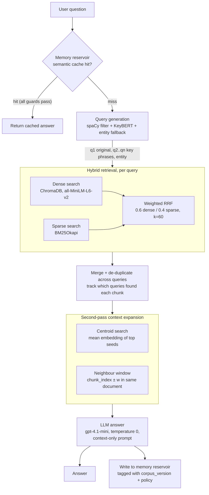
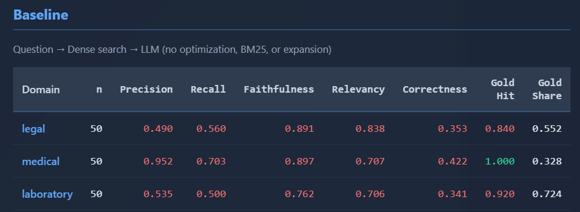
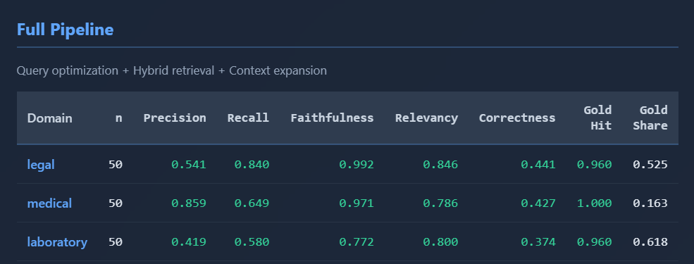

# Retrieval Quality Improvement in RAG

A retrieval-augmented generation (RAG) pipeline that improves on "naive" RAG (embed the question, take the top-k nearest chunks, ask the LLM) by changing **what gets retrieved** before the LLM ever sees it. It combines:

1. **Query generation**: the question is filtered and expanded into several labelled retrieval queries (original question, KeyBERT key phrases, and a named-entity fallback).
2. **Hybrid retrieval**: every query is run against both a dense vector index (ChromaDB) and a sparse BM25 index, and the two rankings are fused with weighted Reciprocal Rank Fusion.
3. **Second-pass context expansion**: a centroid search finds topically related chunks, and a neighbour window restores text cut off at chunk boundaries.
4. **Semantic memory cache**: answers are cached in a separate ChromaDB collection and reused for similar questions. Several guards prevent false hits, and entries expire based on policy.

The pipeline is evaluated with **Ragas** on three domain benchmarks (Indian legal, medical, laboratory; 50 questions each) against a naive-RAG baseline, and with an **LLM-as-judge LangSmith** evaluation on a 30-question NABL 112A accreditation set. A **Streamlit** app shows every stage of the pipeline for any question.

---

## Table of contents

- [Repository layout](#repository-layout)
- [Architecture](#architecture)
  - [1. Query generation](#1-query-generation--rag_optimizerquery_genpy)
  - [2. Hybrid retrieval](#2-hybrid-retrieval--rag_optimizerhybridragpy)
  - [3. Context expansion](#3-context-expansion--rag_optimizercontext_expansionpy)
  - [4. Answer generation](#4-answer-generation--rag_optimizerllmpy)
  - [5. Memory reservoir](#5-memory-reservoir-semantic-cache--rag_optimizermemory_reservoirpy)
- [Setup](#setup)
- [Usage](#usage)
- [Evaluation](#evaluation)
  - [Ragas domain benchmarks](#1-ragas-domain-benchmarks)
  - [NABL 112A LangSmith evaluation](#2-nabl-112a-langsmith-llm-as-judge-evaluation)
- [Tests](#tests)
- [Known limitations](#known-limitations)

---

## Repository layout

```
.
├── README.md
├── 202412180304-NABL-112-A-doc.pdf      # NABL 112A source document (main knowledge base)
├── chroma_db/                            # ChromaDB store: `documents` + `memory` (used by insert_doc.py, eval.py)
├── overall_ragas_evaluation_summary.md   # All three Ragas runs side by side
├── baseline_rag.png / optimized_rag.png  # Ragas result tables (baseline vs full pipeline)
├── evaluation/                           # LangSmith screenshots for the NABL 112A evaluation
└── file/
    ├── app.py                            # Streamlit "RAG Pipeline Explorer" UI
    ├── insert_doc.py                     # Ingests the NABL PDF + two sample texts into `documents`
    ├── eval.py                           # LangSmith LLM-as-judge evaluation (NABL 112A, 30 Qs)
    ├── ragas_eval.py                     # Ragas evaluation on the domain benchmarks
    ├── nabl_112a_rag_evaluation_30.json  # NABL 112A evaluation set
    ├── requirements.txt
    ├── .streamlit/config.toml            # Dark monospace theme for the app
    ├── rag_optimizer/
    │   ├── query_gen.py                  # Question -> labelled retrieval queries
    │   ├── hybridRag.py                  # Chunking/ingestion + dense+BM25 hybrid retrieval (RRF)
    │   ├── context_expansion.py          # Centroid search + neighbour-window second pass
    │   ├── llm.py                        # OpenAI (gpt-4.1-mini) / Gemini answer generators
    │   ├── memory_reservoir.py           # Semantic answer cache with TTL / LRU policies
    │   ├── retriever.py                  # Plain dense-only retriever (reference / legacy)
    │   └── sparse_indexing.py            # Experiment with Chroma's native sparse index (not used by the pipeline)
    ├── benchmarks/
    │   ├── prepare_benchmarks.py         # Builds the legal / medical / laboratory benchmarks
    │   ├── README.md                     # Benchmark sources and construction details
    │   └── data/<domain>/{questions.json, corpus.jsonl}
    ├── chroma_db/                        # ChromaDB store incl. bench_legal / bench_medical / bench_laboratory
    ├── results/
    │   ├── ragas/                        # Full pipeline, no expansion
    │   ├── ragas_both/                   # Full pipeline, centroid + neighbour expansion
    │   └── ragas_baseline/               # Naive RAG baseline
    ├── test_memory_policies.py
    └── test_query_gen.py
```

---

## Architecture



All stages share one ChromaDB `PersistentClient`. Source chunks live in the `documents` collection (or `bench_<domain>` for benchmarks), and cached answers live in a separate `memory` collection, so the cache never changes the knowledge base.

### Ingestion

`ChromaHybridRag.insert_pdf` / `insert_string` extract the text (pypdf for PDFs) and split it into fixed-size overlapping character windows (1000/200 for PDFs and benchmarks, 400/100 by default for raw strings). Each chunk is upserted with the id `<document_id>_chunk_<i>` and metadata `{document_id, source_name, chunk_index}`. Neighbour-window expansion and the benchmark's gold-document check both depend on this metadata. Dense embeddings come from Chroma's default embedding function (`all-MiniLM-L6-v2`, 384-d).

### 1. Query generation (`rag_optimizer/query_gen.py`)

`build_queries(question)` is the single entry point used by the app, `eval.py` and `ragas_eval.py`, so every entry point produces the same queries for the same question.

- **Token filtering (spaCy `en_core_web_sm`)**: stop words and punctuation are removed, with these exceptions:
  - **negations and comparatives** (`not`, `never`, `without`, `less`, `before`, …) are kept, because dropping them can reverse the meaning ("what should I *not* take with nitroglycerin");
  - **numbers and measurement punctuation** (`.`, `/`, `%`, `<`, `>`, …) are kept, so `1.8 mmol/L` and `< 120/80 mmHg` stay intact.
- **Expansion** (only when ≥ 4 content tokens remain):
  - `original`: the raw question, always first;
  - `keyphrase`: KeyBERT (`all-MiniLM-L6-v2`) top 3 key phrases, n-gram range (1, 3), in descending score order;
  - `entity`: the longest named entity or noun chunk, so an over-specific question can still reach chunks that only mention its subject.
- Queries are de-duplicated after normalisation, and their order is deterministic, so runs can be reproduced.

### 2. Hybrid retrieval (`rag_optimizer/hybridRag.py`)

`ChromaHybridRag.retrieve(query, top_k)`:

| Stage | Detail |
|---|---|
| Sparse | `BM25Okapi` over lower-cased whitespace tokens of all chunks (index rebuilt from Chroma on start-up); top `2·top_k` ids |
| Dense | Chroma similarity query (L2 distance); top `2·top_k` ids |
| Fusion | Weighted RRF: `score = Σ w · 1/(k + rank)` with `w_dense = 0.6`, `w_sparse = 0.4`, `k = 60`; top `top_k` kept |

BM25 handles exact matches (clause numbers, drug names, case names, units), and the dense index handles paraphrases. `retrieve_multiple(queries)` runs this for each generated query, merges the results by chunk id, and records `retrieved_by` (the queries that found each chunk). That record is later used to rank chunks.

### 3. Context expansion (`rag_optimizer/context_expansion.py`)

`ContextExpander.expand(docs, mode)` with `mode ∈ {none, centroid, neighbor, both}`:

1. **Seed ranking**: first-pass chunks are ordered by how many queries retrieved them, then by dense distance.
2. **Centroid search** (`centroid_seeds=3`, `centroid_k=3`): the stored embeddings of the top seeds are averaged and L2-normalised, and that vector is used for one more similarity search. This adds up to 3 chunks on the same topic that may share no words with the question.
3. **Neighbour window** (`neighbor_seeds=5`, `window=1`): for the top seeds, chunks `chunk_index ± 1` from the same `document_id` are fetched. This restores sentences split at a chunk boundary.
4. **Ordering**: each seed's neighbours are placed around it in document order, so the LLM reads continuous text. Centroid chunks are appended at the end. Each chunk is tagged `seed`, `neighbor` or `centroid`.

### 4. Answer generation (`rag_optimizer/llm.py`)

`OpenaiRAG` (default) uses `gpt-4.1-mini` at temperature 0 with a prompt that tells the model to *use only the provided context*. All chunks are joined into one context block. `GeminiRAG` is a drop-in alternative; to use it, change `get_rag()` in `app.py`.

### 5. Memory reservoir, semantic cache (`rag_optimizer/memory_reservoir.py`)

The cache stores reusable knowledge as `title → content` pairs (question → answer), not chat history. A cached answer is served only if **all** of these checks pass:

| Guard | Default | Purpose |
|---|---|---|
| Distance threshold | `1.0` (L2) | Candidate must be semantically close |
| Margin vs runner-up | `0.15` | Rejects ambiguous ties between two cached entries |
| Title token overlap (Jaccard) | `≥ 0.2` | Lexical check for close embeddings with unrelated meanings |
| Not expired | per policy | Rejects stale answers |
| `corpus_version` match | SHA-256 of all chunk ids | Any insert/delete in the corpus invalidates older answers |

**Expiration policies.** The policy is set explicitly by the caller or from metadata. If neither is given, it is chosen by matching the question against configurable regexes.

| Policy | TTL (default) | Example trigger |
|---|---|---|
| `stable` | 30 days | Set explicitly |
| `default` | 1 day | No time-sensitive or dynamic keywords |
| `time_sensitive` | 1 hour | "latest", "current", "price", a year like "2024" |
| `dynamic` | **not cached** | "today", "right now", "real-time" |

**Capacity.** The default cap is 500 entries. When the cache is over the cap, expired entries are purged first, and then the least-recently-*served* entries are evicted (LRU). Expiry always counts from creation time, so an entry that is read often still expires on time.

All settings can be overridden with environment variables (`MEMORY_DEFAULT_TTL_SECONDS`, `MEMORY_STABLE_TTL_SECONDS`, `MEMORY_TIME_SENSITIVE_TTL_SECONDS`, `MEMORY_MAX_ENTRIES`, `MEMORY_DISTANCE_THRESHOLD`, `MEMORY_MARGIN`, `MEMORY_TITLE_OVERLAP_FLOOR`, `MEMORY_SKIP_DYNAMIC`, `MEMORY_TIME_SENSITIVE_PATTERNS`, `MEMORY_DYNAMIC_PATTERNS`). An invalid value logs a warning and the default is used instead.

### Streamlit app (`file/app.py`)

"RAG Pipeline Explorer" runs the real pipeline modules and shows what each stage returned: the cache lookup with candidates and guard results, the filtered question and labelled queries, results per query, merged and expanded chunks with their `seed/neighbor/centroid` tags, the prompt, the answer, and live cache statistics. The sidebar controls the knowledge base (`documents` or any `bench_<domain>` collection), `top_k`, cache distance threshold, expansion mode, centroid `k`, neighbour window, and *force regenerate*. When a benchmark collection is selected, its own questions are offered as samples.

---

## Setup

Requires Python 3.10+.

```bash
cd file
python -m venv .venv
.venv\Scripts\activate            # Windows  (source .venv/bin/activate on Linux/macOS)
pip install -r requirements.txt
python -m spacy download en_core_web_sm
```

`eval.py` also needs `pip install langsmith langchain-classic`.

Create a `.env` file (in the directory you run from) with:

```env
OPENAI_API_KEY=sk-...
# Only for eval.py
LANGSMITH_API_KEY=...
# Only if app.py is switched to GeminiRAG
GOOGLE_API_KEY=...
```

> Never commit `.env`. Add it to `.gitignore` before pushing.

---

## Usage

### Ingest documents

```bash
cd file
python insert_doc.py
```

Loads the NABL 112A PDF plus two sample texts (a heart-health guide and a Ferrari Testarossa article, which the app's built-in sample questions refer to) into the `documents` collection of the **repo-root** `chroma_db/`.

### Run the app

```bash
cd file
streamlit run app.py
```

The app opens `./chroma_db` relative to the working directory. When started from `file/` it uses `file/chroma_db`, which contains the benchmark collections.

### Try query generation interactively

```bash
cd file
python -m rag_optimizer.query_gen
```

---

## Evaluation

The project has two evaluations:

| | Ragas domain benchmarks | NABL 112A LangSmith evaluation |
|---|---|---|
| Script | `file/ragas_eval.py` | `file/eval.py` |
| Questions | 3 × 50 (legal, medical, laboratory) | 30 |
| Corpus | One collection per domain with distractor documents | NABL 112A PDF |
| Judge | Ragas metrics, `gpt-4.1-mini` | LangChain criteria evaluators, `gpt-4.1-mini`, scored 1–10 and normalised to 0–1 |
| Compares | Baseline vs pipeline vs pipeline + expansion | Pipeline only |

### 1. Ragas domain benchmarks

#### Datasets

Built by [`file/benchmarks/prepare_benchmarks.py`](file/benchmarks/prepare_benchmarks.py) (seed 42). Details are in [`file/benchmarks/README.md`](file/benchmarks/README.md).

| Domain | Questions | Corpus |
|---|---|---|
| **Legal (India)** | IndicLegalQA: QA over Supreme Court of India judgments | 50 full judgment PDFs (Indian SC Judgments open dataset), matched by decision date and party names |
| **Medical** | PubMedQA `pqa_labeled` (expert-labelled) | 1000 PubMed abstracts: the gold abstract plus all other labelled abstracts as distractors |
| **Laboratory** | LAB-Bench ProtocolQA (19) + LitQA2 (31) | 19 protocols + 50 open-access papers from Europe PMC, including distractors |

All questions are open-ended. Each question has a `source_doc_id`, which is used to check whether retrieval found the correct document.

#### Configurations compared

| Run | Pipeline | Results |
|---|---|---|
| **Baseline** | question → single dense search (top 5) → LLM | `results/ragas_baseline/` |
| **Pipeline, no expansion** | query generation → hybrid dense+BM25 RRF (top 5 per query) → LLM | `results/ragas/` |
| **Full pipeline** | the above + centroid & neighbour-window expansion | `results/ragas_both/` |

All three runs use the same chunking (1000/200), `top_k=5`, generator (`gpt-4.1-mini`) and judge (`gpt-4.1-mini`).

#### Metrics

| Metric | What it measures |
|---|---|
| `context_precision` | Ragas `LLMContextPrecisionWithReference`: are the retrieved chunks relevant, and are the relevant ones ranked high? |
| `context_recall` | Ragas `LLMContextRecall`: does the context contain the claims needed for the reference answer? |
| `faithfulness` | Ragas `Faithfulness`: are the answer's claims supported by the context? |
| `answer_relevancy` | Ragas `ResponseRelevancy`: does the answer address the question? |
| `answer_correctness` | Ragas `AnswerCorrectness`: factual + semantic agreement with the reference answer |
| `gold_doc_hit_rate` | Non-LLM: fraction of questions where ≥ 1 retrieved chunk is from the gold source document |
| `gold_chunk_share` | Non-LLM: fraction of retrieved chunks that are from the gold document |

#### Results

**Baseline (naive RAG)**

| Domain | n | Precision | Recall | Faithfulness | Relevancy | Correctness | Gold hit | Gold share |
|---|---|---|---|---|---|---|---|---|
| legal | 50 | 0.490 | 0.560 | 0.891 | 0.838 | 0.353 | 0.840 | 0.552 |
| medical | 50 | 0.952 | 0.703 | 0.897 | 0.707 | 0.422 | 1.000 | 0.328 |
| laboratory | 50 | 0.535 | 0.500 | 0.762 | 0.706 | 0.341 | 0.920 | 0.724 |

**Pipeline, no expansion (query generation + hybrid retrieval)**

| Domain | n | Precision | Recall | Faithfulness | Relevancy | Correctness | Gold hit | Gold share |
|---|---|---|---|---|---|---|---|---|
| legal | 50 | 0.574 | 0.710 | 0.939 | 0.879 | 0.411 | 0.960 | 0.514 |
| medical | 50 | 0.880 | 0.681 | 0.941 | 0.741 | 0.398 | 1.000 | 0.220 |
| laboratory | 50 | 0.432 | 0.540 | 0.768 | 0.818 | 0.396 | 0.960 | 0.627 |

**Full pipeline (query generation + hybrid retrieval + context expansion)**

| Domain | n | Precision | Recall | Faithfulness | Relevancy | Correctness | Gold hit | Gold share |
|---|---|---|---|---|---|---|---|---|
| legal | 50 | 0.541 | **0.840** | **0.992** | 0.846 | **0.441** | **0.960** | 0.525 |
| medical | 50 | 0.859 | 0.649 | **0.971** | **0.786** | **0.427** | 1.000 | 0.163 |
| laboratory | 50 | 0.419 | **0.580** | **0.772** | **0.800** | **0.374** | **0.960** | 0.618 |

**Mean across the three domains**

| Metric | Baseline | No expansion | Full pipeline | Δ full vs baseline |
|---|---|---|---|---|
| Context precision | **0.659** | 0.629 | 0.606 | −0.053 |
| Context recall | 0.588 | 0.644 | **0.690** | **+0.102** |
| Faithfulness | 0.850 | 0.883 | **0.912** | **+0.062** |
| Answer relevancy | 0.750 | **0.813** | 0.811 | **+0.061** |
| Answer correctness | 0.372 | 0.402 | **0.414** | **+0.042** |
| Gold doc hit rate | 0.920 | **0.973** | **0.973** | **+0.053** |




#### Findings

- **Recall, grounding and correctness improve.** Compared with naive RAG, the full pipeline raises mean context recall by about 10 points, faithfulness by about 6, answer relevancy by about 6 and answer correctness by about 4. It also finds the gold document more often (92% → 97%).
- **Legal gains the most** (recall +0.28, faithfulness +0.10, gold hit 84% → 96%). Legal questions name parties, sections and dates, which BM25 matches exactly and pure dense search tends to miss. Neighbour-window expansion also restores long judgment passages split across chunks.
- **Expansion mostly helps recall and faithfulness.** Going from no expansion to the full pipeline, legal recall rises from 0.71 to 0.84 and medical faithfulness from 0.94 to 0.97.
- **Precision is lower.** More queries and more expanded chunks mean more off-target chunks in the context, so context precision and gold-chunk share fall, most visibly on medical. Medical questions are single abstracts that dense search already finds well (baseline precision 0.95), so extra context has less to add there. The LLM still answers more faithfully, which suggests it ignores most of the extra chunks.
- **Laboratory is the hardest domain** for every configuration. LitQA2 questions ask for specific findings buried in full-length papers, and the reference answers are often very short.

Re-run with:

```bash
cd file
python benchmarks/prepare_benchmarks.py       # build datasets (cached downloads)
python ragas_eval.py --baseline               # naive RAG
python ragas_eval.py --expansion none         # pipeline without expansion
python ragas_eval.py --expansion both         # full pipeline (default)
python ragas_eval.py --domains medical --limit 5   # quick smoke test
```

Pipeline outputs and scores are cached for each question, so a re-run only fills in missing or failed (NaN) cells. Use `--rerun-pipeline` after changing the pipeline and `--rescore` to judge again.

### 2. NABL 112A LangSmith LLM-as-judge evaluation

`file/eval.py` uploads [`nabl_112a_rag_evaluation_30.json`](file/nabl_112a_rag_evaluation_30.json) (30 questions with ground-truth answers on NABL 112A, *Specific Criteria for Accreditation of Medical Laboratories*) to LangSmith as a dataset. It then runs the pipeline (query generation + hybrid retrieval, `top_k=5`) on each question and scores the output with four `gpt-4.1-mini` criteria judges (scored 1–10, normalised to 0–1).

| Metric | Average (30 runs) |
|---|---|
| Answer relevancy | **0.90** |
| Context precision | **0.77** |
| Context recall | **0.71** |
| Faithfulness | **1.00** |
| Latency (P50 / P99) | ≈ 2.5 s / ≈ 5.1 s |
| Error rate | 0 |


Faithfulness is 1.00 on every question: the answers never go beyond the retrieved text. The lower scores are all context recall, on questions whose reference answers combine requirements from several separate clauses (e.g. Q2, Q7, Q10 at 0.2–0.3). The per-question breakdown is in [`evaluation/eval_1_10.png`](evaluation/eval_1_10.png), [`eval_11_20.png`](evaluation/eval_11_20.png) and [`eval_21_30.png`](evaluation/eval_21_30.png), and latency and error rate are in [`latency.png`](evaluation/latency.png) and [`error rate.png`](evaluation/error%20rate.png).

Run (from the repo root, after `insert_doc.py`; the script imports `file.rag_optimizer.*`):

```bash
python -m file.eval
```

---

## Tests

Neither test script needs an API key.

```bash
cd file
python test_memory_policies.py   # TTL policies, classification, expiry, LRU eviction, corpus-version invalidation
python test_query_gen.py         # token filtering, negation/measurement preservation, query ordering
```

- `test_memory_policies.py` uses a temporary ChromaDB and a deterministic offline embedding function, so the app's collections are not touched.
- `test_query_gen.py` needs spaCy and KeyBERT installed. If either is missing, its checks are reported as SKIPPED rather than failed.

Each script exits non-zero on failure.

---

## Known limitations

- **Two ChromaDB stores.** `insert_doc.py` and `eval.py` use the repo-root `chroma_db/`. `app.py` and `ragas_eval.py` use `./chroma_db` relative to the working directory (normally `file/chroma_db/`). Run scripts from the directories shown above, or point them all at one path.
- **BM25 is in memory.** The BM25 index is rebuilt from the whole collection for every query. This is fine for thousands of chunks but will not scale to very large corpora. `rag_optimizer/sparse_indexing.py` tests Chroma's native sparse index as a possible replacement.
- **Fixed-size character chunking** can split sentences and tables. Neighbour-window expansion reduces the problem but does not remove it.
- **LLM-judged metrics vary.** All quality scores come from a single `gpt-4.1-mini` judge over 30–50 questions per set, so small differences (±0.02–0.03) should not be treated as significant.
